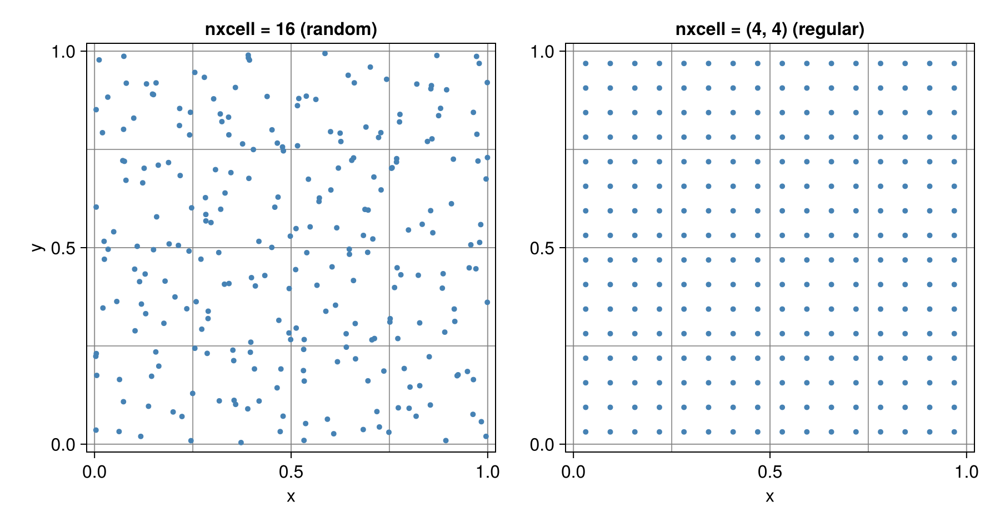

# Particles

## Memory layout

`Particles` and `MarkerChain` store coordinates in `CellArray`s from
[`CellArrays.jl`](https://github.com/omlins/CellArrays.jl). Entries are grouped
by parent cell so that interpolation, advection, and reinjection routines work
on spatially local chunks of memory.

## Particle objects

JustPIC exposes three concrete `AbstractParticles` containers:

- `Particles`: the main cell-sorted container used for PIC workflows.
- `PassiveMarkers`: lightweight tracers stored as flat coordinate arrays.
- `MarkerChain`: a 2D interface-tracking container for free surfaces and similar boundaries.

`Particles` stores coordinates, active-slot masks, occupancy thresholds, and the
derived center, vertex, and velocity grids used by the high-level APIs. Those
extra fields are what let helpers such as `move_particles!`, `grid2particle!`,
`particle2grid!`, `inject_particles!`, `update_phase_ratios!`, and
`subgrid_diffusion!` use the compact `(..., particles, ...)` call style.

`particles.np` is the initial storage capacity (`max_xcell * number of cells`),
not a live-particle count. Reduce the occupancy mask when a live count is
needed.

## Initialization

`init_particles` accepts either:

- a scalar `nxcell` for random, quadrant-balanced seeding inside each cell, or
- a tuple `nxcell` for a regular per-dimension layout, where `nxcell[d]`
  particles are placed at the centers of a uniform sub-grid of spacing
  `dx[d] / nxcell[d]` along dimension `d`.

If `max_xcell` is smaller than the resulting number of particles per cell, it is
raised to match.

After construction, the returned `Particles` object already contains the center,
vertex, and staggered velocity grids needed by the higher-level APIs.

The two layouts on a 4x4 grid with 16 particles per cell:



### Randomly distributed particles

```julia
backend   = JustPIC.CPU # device backend
nxcell    = 24  # initial number of randomly distributed particles
max_xcell = 48  # maximum number of particles per cell
min_xcell = 12  # minimum number of particles per cell
n         = 32  # number of vertices per dimension
Lx   = Ly = 1.0 # domain size
xvi       = xv, yv = LinRange(0, Lx, n), LinRange(0, Ly, n) # nodal vertices
dxi       = dx, dy = xv[2] - xv[1], yv[2] - yv[1]
xci       = xc, yc = LinRange(dx / 2, Lx - dx / 2, n - 1), LinRange(dy / 2, Ly - dy / 2, n - 1)
grid_vx   = xv, LinRange(first(yc) - dy, last(yc) + dy, length(yc) + 2)
grid_vy   = LinRange(first(xc) - dx, last(xc) + dx, length(xc) + 2), yv
## initialize particles object with randomly distributed coordinates
particles = init_particles(
    backend, nxcell, max_xcell, min_xcell, grid_vx, grid_vy,
)
```

### Regularly spaced particles

```julia
backend   = JustPIC.CPU # device backend
nxcell    = (5, 5)  # number of evenly spaced particles in each cell dimension
max_xcell = 48      # maximum number of particles per cell
min_xcell = 12      # minimum number of particles per cell
n         = 32      # number of vertices per dimension
Lx   = Ly = 1.0     # domain size
xvi       = xv, yv = LinRange(0, Lx, n), LinRange(0, Ly, n) # nodal vertices
dxi       = dx, dy = xv[2] - xv[1], yv[2] - yv[1]
xci       = xc, yc = LinRange(dx / 2, Lx - dx / 2, n - 1), LinRange(dy / 2, Ly - dy / 2, n - 1)
grid_vx   = xv, LinRange(first(yc) - dy, last(yc) + dy, length(yc) + 2)
grid_vy   = LinRange(first(xc) - dx, last(xc) + dx, length(xc) + 2), yv
## initialize particles object with regularly distributed coordinates
particles = init_particles(
    backend, nxcell, max_xcell, min_xcell, grid_vx, grid_vy,
)
```

## Particle maintenance

These helpers keep the cell-sorted storage healthy as particles move:
`move_particles!`, `inject_particles!`, `inject_particles_phase!`,
`clean_particles!`, `force_injection!`, `cell_index`, and `cell_length`.

Once `particles` has been initialized, most transfer and maintenance routines
use the geometry stored in the container directly:

```julia
grid2particle!(Fp, F, particles)
particle2grid!(F, Fp, particles)
move_particles!(particles, particle_args)
inject_particles!(particles, particle_args)
update_phase_ratios!(phase_ratios, particles, phases)
```

This is the preferred high-level style for simulation code, tests, and examples.

### Injection against a free surface

For 2D marker-chain models, opt into separate rock and air occupancy targets:

```julia
move_particles!(particles, (phases, particle_args...))
# Advance the marker chain before replenishing the particles.
inject_particles_phase!(particles, phases, particle_args, chain; air_phase = 5)
update_phase_ratios!(phase_ratios, particles, phases)
```

This overload removes particles on the wrong side of the chain and seeds each
nonempty rock/air portion of a quadrant directly, including thin slivers. It
copies phase and all companion fields from a live same-side donor in the physical
3×3 neighborhood. New particles do not become donors within the same call.
Pass every history field that must follow the material in `particle_args`.
Existing valid particles retain their histories. Grid-field injection remains
available through the existing overload that takes `fields` as its fourth argument.

To prescribe material entering through the vertical sides, supply a backend-callable
`boundary_initializer(position, is_air)` returning `(phase, values)`. The tuple
`values` must match `particle_args`; the phase must agree with the side of the
chain, and all returned values must be finite. It is used only for newly injected
particles in the leftmost/rightmost physical columns, regardless of flow direction.
The caller chooses the incoming layers, temperature and deformation/stress history.

The call throws if a rock/air target cannot be filled because donors are absent,
capacity is exhausted or the initializer returns invalid data. Successful partial
updates remain applied: save the pre-step state if rollback is needed. Ensure
capacity allows both materials in cut quadrants, which can require one extra
particle per quadrant beyond the usual rounded target. For a distributed run,
physical boundaries and rank interfaces need separate treatment; this prototype
uses only physical interior donors and has not been validated under MPI.

Rejecting an unconverged mechanical solve and keeping a consistent accepted
timestep remain responsibilities of the solver caller; injection cannot repair
already-invalid mechanical history.

## API

### Containers

```@docs
Particles
PassiveMarkers
```

### Initialization

```@docs
init_particles
init_passive_markers
init_cell_arrays
```

### Advection

```@docs
AbstractAdvectionIntegrator
Euler
RungeKutta2
RungeKutta4
set_precision
advection!
advection_LinP!
advection_MQS!
semilagrangian_advection!
semilagrangian_advection_LinP!
semilagrangian_advection_MQS!
```

### Maintenance

`move_particles!` drops particles whose destination cell is full; pass
`verbose=true` to print the number dropped. Overflow removes the particle and
its companion fields together. `clean_particles!` removes active particles
outside their stored cell; it does not compact slots. Injection with companion
fields requires a live neighboring particle from which to copy field values.
If that support is absent, the candidate is skipped rather than initialized
with synthetic field data.

```@docs
move_particles!
inject_particles!
inject_particles_phase!
clean_particles!
force_injection!
```

### Phase ratios and subgrid diffusion

```@docs
PhaseRatios
nphases
subgrid_diffusion!
subgrid_diffusion_centroid!
SubgridDiffusionCellArrays
```
